# Manual de Usuario — ENVIA ERP

**Versión:** 1.6.0 · **Fecha:** noviembre de 2026

**Para:** Usuarios del sistema ENVIA ERP
**Cómo abrir:** Doble clic en `index.html` en Google Chrome

---

## Índice

1. [Cómo entrar al sistema](#1-como-entrar-al-sistema)
2. [Panel principal (Dashboard)](#2-panel-principal-dashboard)
3. [Clientes](#3-clientes)
4. [Conductores y Flota](#4-conductores-y-flota)
5. [Servicios (Carreras y Encomiendas)](#5-servicios-carreras-y-encomiendas)
6. [Contabilidad (libros y estados)](#6-contabilidad-libros-y-estados)
7. [Tributos y Tasa BCV](#7-tributos-y-tasa-bcv)
8. [Cuentas por Pagar (proveedores y facturas)](#8-cuentas-por-pagar-proveedores-y-facturas)
8.1 [Negocios Asociados](#81-negocios-asociados)
8.2 [Tienda & Inventario del conductor](#82-tienda--inventario-del-conductor)
9. [Bitácora de Auditoría](#9-bitacora-de-auditoria)
10. [Usuarios del sistema](#10-usuarios-del-sistema)
10.1 [Configuración del Sistema](#10-configuración-del-sistema)
10.2 [Asistente ChatBot](#configuración-de-asistente-chatbot)
11. [Reportes en cada módulo](#11-reportes-en-cada-modulo)
12. [Reglas importantes que debes conocer](#12-reglas-importantes-que-debes-conocer)

---

## 1. Cómo entrar al sistema

### Paso 1 — Abrir la aplicación
Haz doble clic en el archivo `index.html` o arrástralo a una ventana de Google Chrome. La aplicación se abre directamente en tu navegador, no necesita internet ni servidor.

### Paso 2 — Iniciar sesión
En la pantalla de bienvenida verás el logotipo de ENVIA y dos campos:

| Campo | Qué escribir |
|-------|-------------|
| Usuario | `ENVIA` |
| Clave de acceso | `123456789` |

Las credenciales de demostración ya vienen precargadas. Solo presiona **"Ingresar"** para entrar. Si necesitas usar otro usuario, borra el campo y escribe sus credenciales.

### Paso 3 — Ver tu sesión
Al entrar, verás tu nombre, tu rol y la tasa del dólar (BCV) en la parte superior derecha. Tu sesión dura 12 horas y se cierra automáticamente.

Cada vez que inicies sesión, el sistema abrirá siempre el **Dashboard**, aunque antes hayas estado trabajando en otro módulo. Así empiezas con la visión general de la operación.

El **menú lateral** está organizado por grupos (Operación, Maestros, Finanzas, Sistema). Cada módulo es un botón desplegable (acordeón): al hacer clic en el nombre del módulo se abre su pantalla principal y se despliegan sus opciones internas. Por ejemplo, en **Contabilidad** verás *Libro Diario*, *Libro Mayor*, *Balance de Comprobación*, *Estado de Resultados*, etc. Al hacer clic en cualquiera de estas opciones, el módulo muestra directamente ese contenido (no siempre la misma pantalla principal). Si estás dentro de un submódulo y pulsas de nuevo el nombre del módulo, vuelves a su pantalla principal; lo mismo ocurre al pulsar **Dashboard** desde cualquier parte del menú.

**Reportes** siempre aparece como última opción dentro de cada módulo. Los módulos sin subopciones (como **Dashboard** y **Bitácora de Auditoría**) se abren directamente al hacer clic. El menú se adapta a la altura de la pantalla: en pantallas de portátil reduce los espacios para que veas todas las opciones sin desplazarte. En **móvil**, toca el icono de menú (☰) para abrir la navegación y usa el botón **Cerrar sesión** al final del menú. En escritorio puedes cerrar sesión con el icono de salida de la barra superior.

### Paso 4 — Conocer el espacio de trabajo

La versión **1.14.0** incorpora el **Asistente Inteligente ENVIA** y consolida el rediseño **ENVIA Spatial OS**, la ficha de consulta de inventario con kardex resumido y el resumen de errores de sincronización con detalle por registro:

- **Acceso centrado:** el login es una sola tarjeta en el centro de la pantalla, sin panel lateral. En móvil se ajusta al ancho disponible y puedes desplazarte verticalmente si el formulario no cabe completo.
- **Dock flotante:** el menú lateral es una cápsula de cristal con indicador luminoso de la sección activa. El título del módulo abre su pantalla; la flecha solo expande o recoge sus opciones.
- **Command palette:** pulsa `Ctrl + K` (o `⌘ + K` en Mac) en cualquier momento para buscar módulos, cédulas, RIF, números de factura, servicios y productos. Usa las flechas para moverte y `Enter` para abrir. En móvil puedes tocar el icono de lupa de la barra superior.
- **Temas:** el conmutador de la barra superior alterna entre **Dark Fintech** y **Light Spatial**. La preferencia se conserva en tu navegador.
- **Dashboard Bento:** las métricas se organizan en celdas de distinto tamaño. Las tablas del sistema se muestran como filas-tarjeta con hover; si hay muchas columnas, desplázate horizontalmente.
- **Fichas y documentos:** las tarjetas de documentos abren una vista previa ampliada. Los archivos se guardan en Supabase Storage o localmente si no hay conexión.
- **Cápsula BCV:** muestra la tasa oficial como `LIVE`; al pasar el cursor ves la conversión rápida de USD a VES y de 1.000 Bs a USD.
- **Asistente Inteligente:** botón flotante en la esquina inferior derecha. Configura tu API Key de Google Gemini en Configuración → Asistente ChatBot y consulta con las preguntas rápidas; si no tienes acceso a Configuración, pide a un SuperAdmin que la configure en este navegador.

> Si alguna vez necesitas volver al diseño anterior, ejecuta `revertir_diseno.ps1` desde la carpeta del proyecto. El respaldo está en `_backup_diseno_original/`.

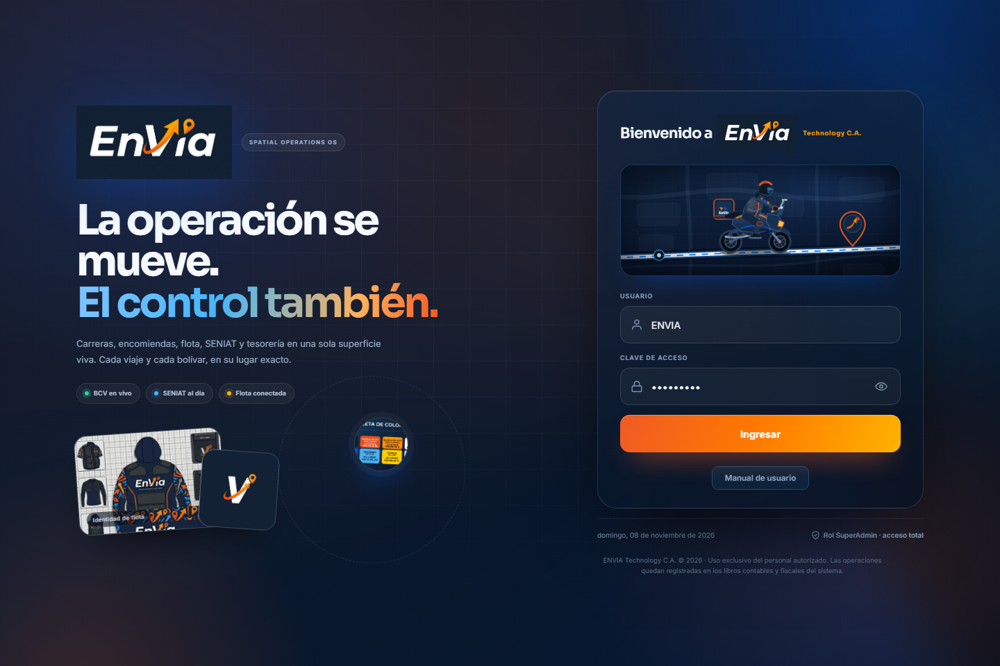

> Si olvidas la clave, contacta a la persona encargada del sistema en tu empresa. No hay forma de recuperarla desde el login.

---

## 2. Panel principal (Dashboard)

Al entrar, ves siempre el **Dashboard** organizado como un tablero de operación. No se restaura el último módulo visitado:

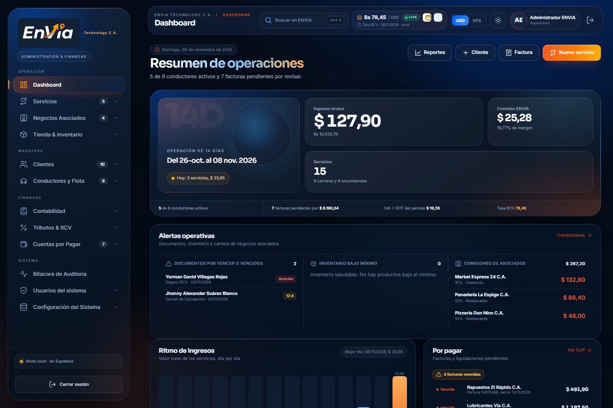

### Banda de operación (14 días)

Arriba, la banda azul resume el período:

- **Ingresos brutos** y su equivalente en bolívares.
- **Comisión ENVIA** y el margen sobre lo facturado.
- **Servicios** realizados, separados en carreras y encomiendas.
- **Hoy:** cuántos servicios van y cuánto generaron.
- En la franja inferior: conductores activos, facturas pendientes, IVA + IGTF del período y la tasa BCV aplicada.

### Ritmo de ingresos

Gráfico de barras de los últimos 14 días. La barra naranja es hoy y la más alta se resalta en azul. Abajo ves el promedio diario. Pasa el mouse sobre una barra para ver la fecha y el monto exacto.

### Por pagar

Lista de facturas de proveedores pendientes, ordenadas por fecha de vencimiento. Las vencidas se marcan en naranja. Al final se muestran el total de facturas pendientes y las liquidaciones a conductores. Haz clic en una factura para abrir su detalle o en **Ver CxP** para ir al módulo completo.

### De dónde viene y cómo se cobra

- **Composición del ingreso:** cuánto entra por carreras y cuánto por encomiendas, con montos y porcentajes.
- **Métodos de cobro:** cuánto se cobró por Pago Móvil, Efectivo USD, Wallet, Tarjeta y Zelle.
- Debajo: comisión retenida, IVA + IGTF, total cobrado y ticket promedio.

### Servicios recientes

Tabla con los últimos 8 servicios. Haz clic en el cliente o en el conductor para abrir su ficha, o en **Ver historial** para ir al módulo de Servicios.

> Todos los montos se muestran en dólares (USD) y en bolívares (VES) con la tasa del BCV vigente. La tasa se actualiza automáticamente al iniciar sesión.

---

## 3. Clientes

Los clientes son las personas o empresas a las que les prestas servicio de traslado o encomienda.

### Ver la lista de clientes
Ve al menú lateral → **Clientes** → **Listado de clientes**. Verás una tabla con todos los clientes registrados, su cédula/RIF, teléfono, saldo en la billetera y cuántos servicios han tenido.

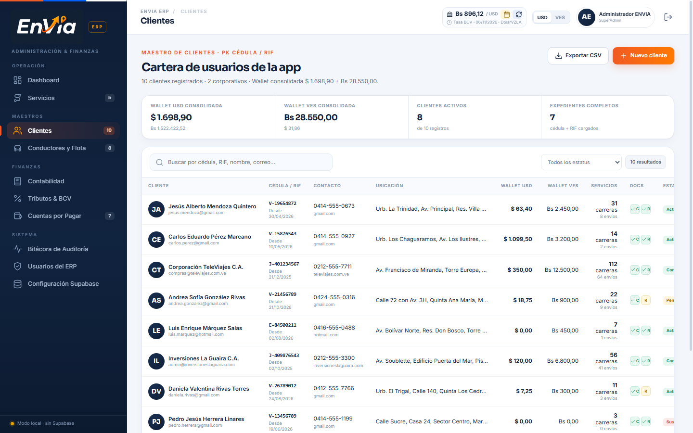

### Agregar un cliente nuevo
1. En la pantalla de Clientes, busca el botón para agregar nuevo (generalmente dice "Nuevo cliente" o tiene un icono de más).
2. Llena los campos obligatorios:
   - **Cédula / RIF:** Ejemplo `V-12345678`, `E-12345678` o `J-123456789`. Es la identificación única del cliente y no se puede repetir.
   - **Nombres y Apellidos**
   - **Teléfono móvil**
   - **Correo electrónico**
   - **Dirección completa**
   - **Estatus:** Activo, Suspendido, Pendiente o Corporativo.
3. Presiona **Guardar**.

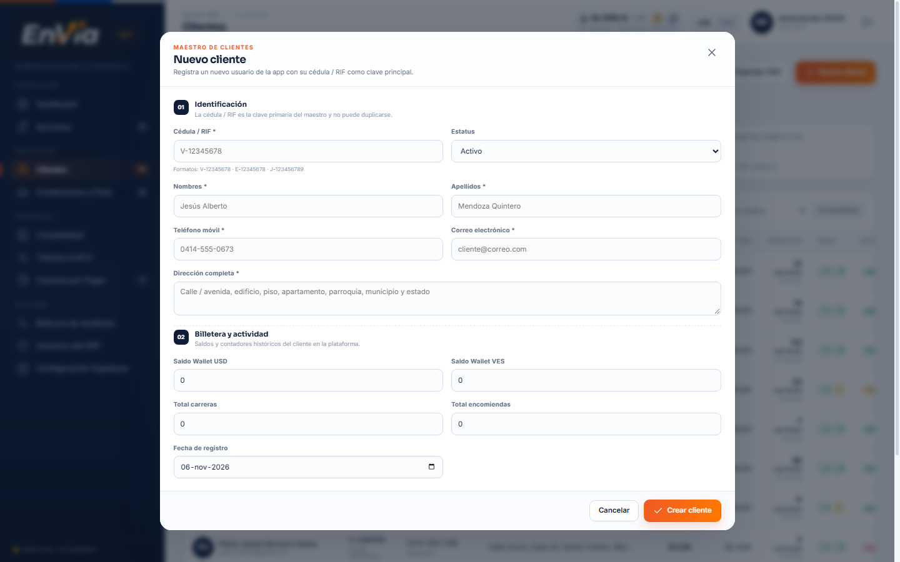

### Editar un cliente
1. En la lista, haz clic sobre el nombre del cliente que quieres editar.
2. Cambia los campos que necesites (excepto la cédula/RIF, que no se puede cambiar una vez creado).
3. Presiona **Guardar**.

> No se puede eliminar un cliente que tenga servicios registrados.

---

## 4. Conductores y Flota

Los conductores son las personas que realizan las carreras y entregas. Reciben un pago por cada servicio.

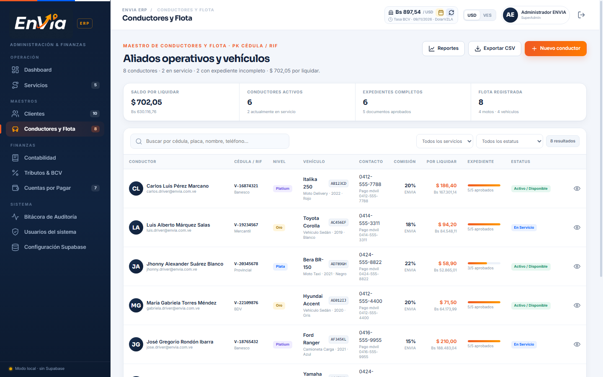

### Registrar un conductor
1. Ve al menú lateral → **Conductores y Flota** → **Maestro de conductores** (o **Nuevo conductor**).
2. Haz clic en el botón para agregar conductor nuevo.
3. Llena los datos personales:
   - Cédula / RIF (único, no se repite).
   - Nombres y apellidos.
   - **Nivel del conductor:** Zafiro, Esmeralda o Diamante.
   - **Tarifa del conductor:** fija (monto semanal) o porcentual (% de lo generado). Define cuál de los planes configurados para su nivel se descuenta al aplicar el plan semanal.
   - Teléfono y correo.
   - Dirección.
4. Llena los datos del vehículo:
   - Tipo de servicio (Moto Delivery, Carro, etc.).
   - Placa, marca, modelo, año y color.
5. Llena los datos de pago:
   - Banco, número de cuenta.
   - Teléfono y cédula de Pago Móvil.
   - Porcentaje de comisión (cuánto se queda ENVIA de cada carrera).
6. Presiona **Guardar**.

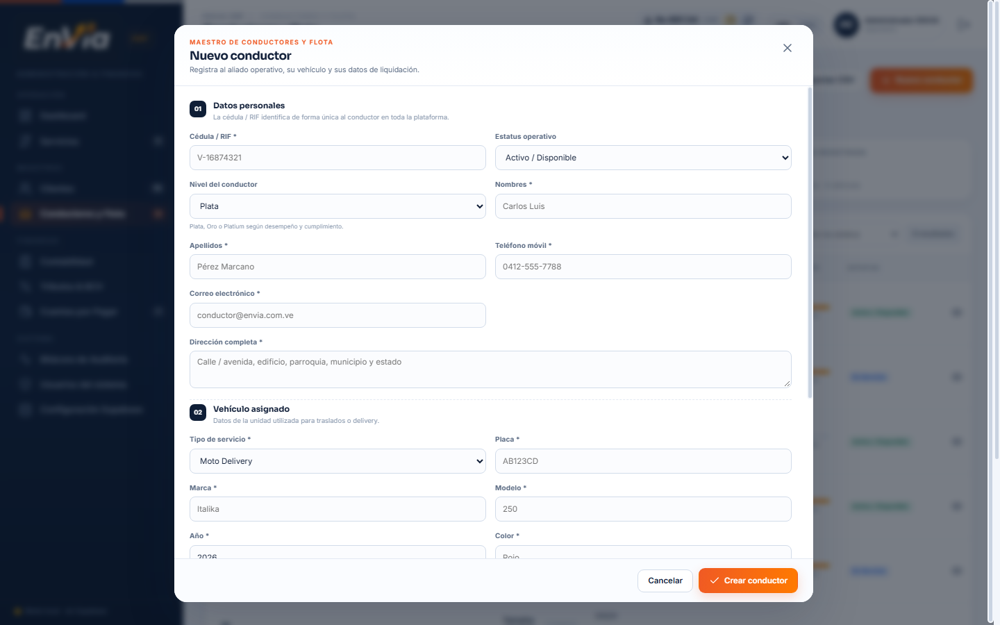

### Niveles del conductor

| Nivel | Uso sugerido |
|-------|--------------|
| **Zafiro** | Conductor nuevo o en período de evaluación. |
| **Esmeralda** | Conductor con buen desempeño y cumplimiento. |
| **Diamante** | Conductor destacado o de máxima prioridad operativa. |

El nivel se muestra como una etiqueta en el listado y se incluye en los reportes de conductores y liquidaciones. Puedes cambiarlo editando el expediente del conductor.

### Documentos del conductor
Cada conductor debe tener documentos que pueden estar en tres estados: Pendiente, Aprobado o Rechazado.
- Cédula
- RIF
- Licencia de conducir
- Tarjeta de circulación
- **Seguro RCV** (responsabilidad civil de vehículos)

Cuando todos los documentos estén **Aprobados**, el conductor puede pasar de "En Revisión" a **Activo / Disponible** y podrá recibir carreras.

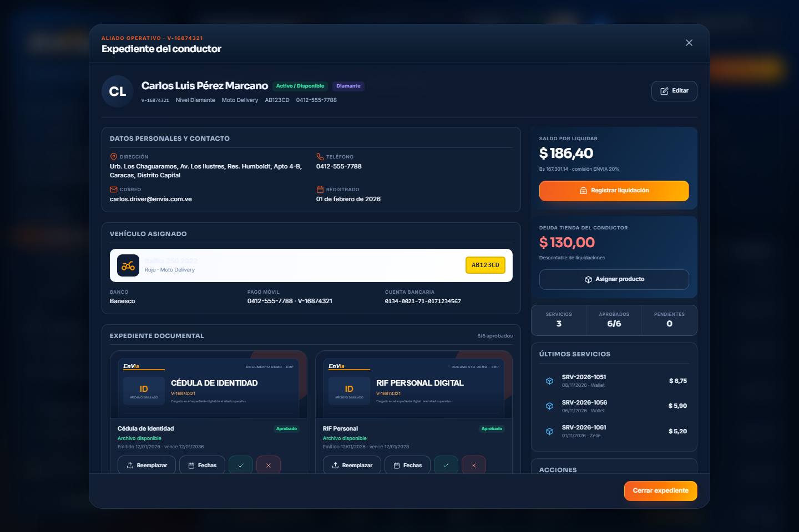

### Fechas, alertas y lectura IA de documentos

Cada documento guarda su **fecha de emisión** y **fecha de vencimiento**. Al subir o reemplazar un archivo, el sistema abre un cuadro para registrarlas:

1. Si el administrador configuró un servicio de visión (IA), pulsa **“Leer fechas con IA”** y el sistema intenta extraerlas de la foto.
2. Si no hay servicio configurado o la lectura falla, escribe las fechas manualmente. El flujo nunca se bloquea.
3. Pulsa **“Guardar fechas”**.

El ERP marca los documentos que vencen en **30 días o menos** y los que ya están **vencidos**. Si un documento obligatorio está vencido, el conductor pasa automáticamente a **Inactivo por Documentos Vencidos** y no se le pueden asignar servicios. Cuando sube el documento actualizado y registra una nueva fecha futura, el sistema lo reactiva.

La configuración de lectura IA se guarda solo en el navegador del administrador (`Configurar IA` dentro del cuadro de fechas). En producción debe usarse un proxy del servidor para no exponer claves.

### Wallet e historial del conductor

Dentro del expediente, la sección **Wallet del conductor** muestra el detalle de cada movimiento:

- **Ganancias brutas** por servicios.
- **Comisiones ENVIA** descontadas.
- **Compras de la tienda** financiadas.
- **Liquidaciones pagadas**.
- **Saldo wallet** y **deuda de tienda** pendiente.

Este historial se conserva en el ERP para estadísticas y para explicar cualquier diferencia de liquidación.

> No se puede eliminar un conductor que tenga servicios registrados.

---

## 5. Servicios (Carreras y Encomiendas)

Aquí registras cada viaje o entrega que se hace.

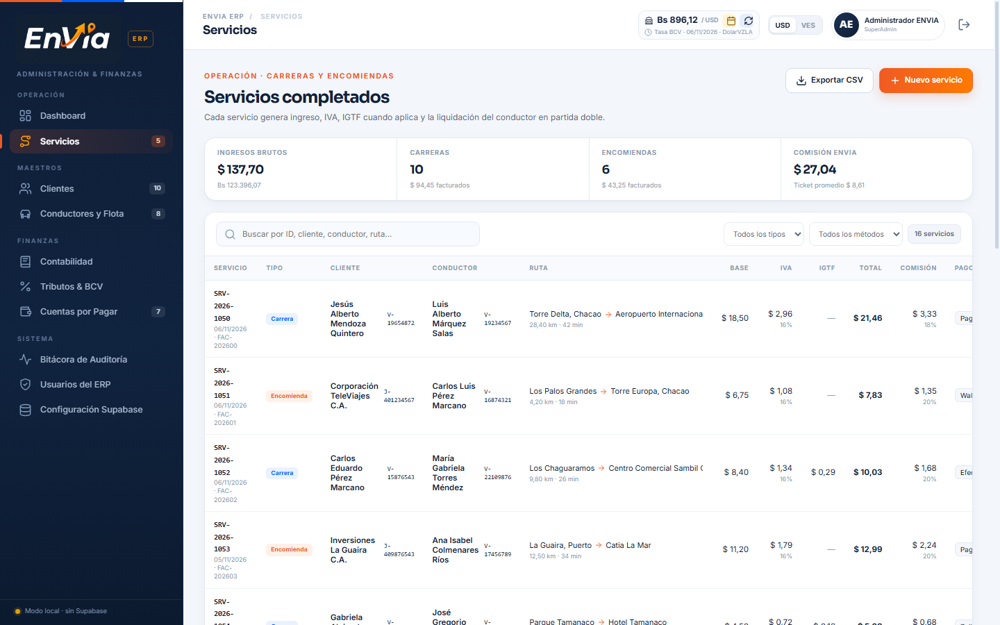

### Crear un servicio nuevo
1. Ve al menú lateral → **Servicios** → **Listado de servicios** (o **Nuevo servicio**).
2. Haz clic en el botón para agregar servicio nuevo.
3. Selecciona:
   - **Tipo:** Carrera (traslado de persona) o Encomienda (entrega de paquete).
   - **Cliente:** Debe estar registrado en Clientes.
   - **Conductor:** Debe estar registrado y activo.
   - **Origen y destino:** Direcciones de salida y llegada.
   - **Kilómetros y minutos:** Distancia y tiempo del viaje.
   - **Base en USD:** El monto cobrado al cliente (sin impuestos).
   - **IVA %:** 16 (general), 8 (reducido) o 0 (exento).
   - **Método de pago:** Pago Móvil, Wallet, Efectivo USD, Zelle o Tarjeta.
   - **Número de factura y control:** Si aplica.
4. Presiona **Guardar**.

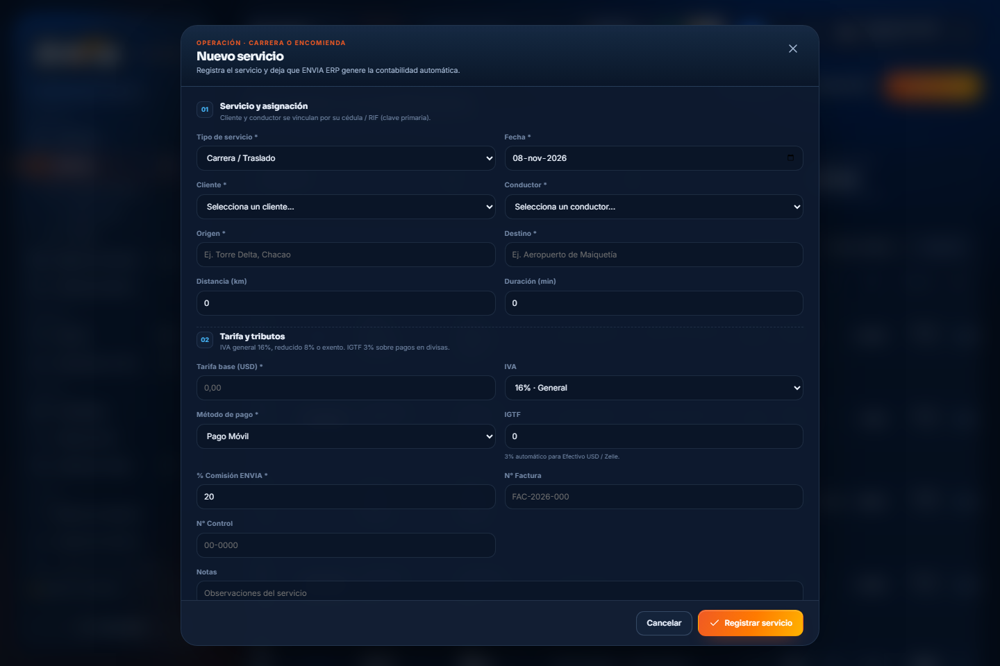

### Qué pasa automáticamente al guardar
El sistema hace lo siguiente solo:
- Crea el ingreso contable en bolívares (usando la tasa del dólar del día).
- Calcula el IVA y el IGTF (3% si el pago es en efectivo USD o Zelle).
- Calcula la comisión del conductor.
- Suma el saldo que le debes al conductor.
- Resta del monto de la billetera del cliente si pagó con Wallet.

> No puedes crear un servicio si el cliente o el conductor no existen en sus respectivos maestros.

---

## 6. Contabilidad (libros y estados)

ENVIA ERP lleva la contabilidad automática en bolívares (VES). Cada servicio, factura o pago genera sus asientos contables solos.

### Qué puedes ver y imprimir
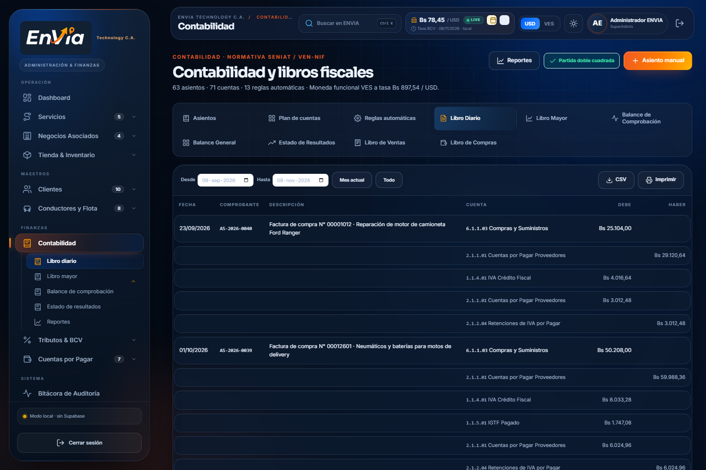

Desde el menú lateral → **Contabilidad** puedes consultar:

| Reporte | Qué muestra |
|---------|-------------|
| Libro Diario | Todos los asientos contables en orden de fecha. |
| Libro Mayor | El movimiento de cada cuenta contable. |
| Balance de Comprobación | Si los debitos y créditos están equilibrados. |
| Estado de Resultados | Ingresos, costos y gastos del período. |
| Balance General | Activos, pasivos y patrimonio de la empresa. |
| Libro de Ventas | Facturas emitidas con IVA e IGTF (para el SENIAT). |
| Libro de Compras | Facturas de proveedores con retenciones. |

### Navegación entre libros y estados
Las opciones de Contabilidad se muestran en una cuadrícula de pestañas que se ajusta al ancho de la pantalla. Ya no necesitas desplazarte horizontalmente para encontrar Libro Diario, Libro Mayor, Balance de Comprobación, Estado de Resultados, Balance General, Libro de Ventas o Libro de Compras.

### Cómo imprimir o exportar
En la esquina superior derecha de Contabilidad, y de todos los demás módulos, está el botón **Reportes**. Desde allí puedes:
- **Imprimir:** abre el diálogo de impresoras del navegador con una versión limpia del reporte.
- **Excel:** descarga un archivo `.xls` que se abre directamente en Microsoft Excel o LibreOffice.

El centro de reportes se explica con detalle en la [sección 11](#11-reportes-en-cada-modulo).

> Todos los reportes muestran la tasa del BCV utilizada, el usuario que los generó y la fecha de emisión. Los reportes contables incluyen además el período consultado.

---

## 7. Tributos y Tasa BCV

Desde el menú lateral → **Tributos & BCV** ves los parámetros fiscales de la empresa:

| Parámetro | Valor |
|-----------|-------|
| Tasa BCV (Bs por USD) | **Solo lectura** — se actualiza desde DolarVZLA o por fecha |
| IVA general | 16% |
| IVA reducido | 8% |
| IVA exento | 0% |
| IGTF | 3% (sobre pagos en divisas) |
| Unidad Tributaria | 90 Bs |

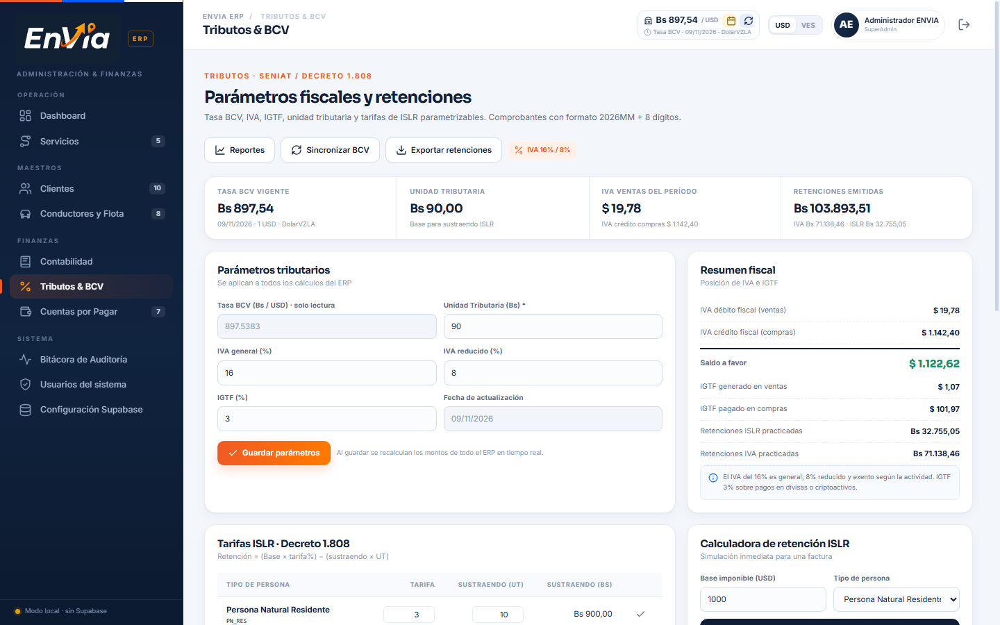

### Tasa automática (DolarVZLA)

ENVIA ERP consulta la **tasa oficial del BCV** automáticamente mediante DolarVZLA cada vez que inicias sesión. En la barra superior verás el indicador:

> 🏦 **Tasa BCV — Bs [valor] / USD**  
> 🕐 debajo, la fecha de la tasa y la fuente (`DolarVZLA`).

- La tasa **no se puede subir ni bajar manualmente**: es de solo lectura para evitar errores contables.
- Se guarda en la sesión del navegador para no saturar la API y se usa en todos los cálculos (servicios, cuentas por pagar, dashboard, contabilidad).
- Para forzar una consulta nueva de la tasa vigente, haz clic en el botón **⟳** junto a la tasa, o usa **Tributos & BCV → Sincronizar BCV**.

### Consultar la tasa de una fecha (calendario)

Junto a la tasa hay un icono de **calendario** 🗓️:

1. Haz clic en el icono de calendario.
2. Selecciona la fecha que necesitas (solo aparecen fechas con tasa publicada).
3. Presiona **Aplicar tasa**.

La tasa de esa fecha se aplica a todos los cálculos y el indicador cambia a **`DolarVZLA · histórica`** con el borde amarillo. Usa **Tasa de hoy** en el mismo cuadro para volver a la tasa vigente.

> Si eliges un fin de semana o feriado sin tasa publicada, el sistema usará automáticamente la fecha hábil más cercana anterior y te avisará.

### Si la API no responde

Si no hay internet o DolarVZLA no está disponible, el sistema **conserva la última tasa conocida** y muestra un aviso. La tasa no se edita manualmente: cuando se recupere la conexión, usa **⟳** para actualizarla.

> Solo los roles o usuarios con el permiso de edición de Tributos ven los controles de calendario y actualización. Los roles de solo lectura, como Auditor / Operaciones, únicamente visualizan la tasa. Los roles personalizados reciben exactamente los permisos que les asigne el administrador.

Todos los nuevos servicios y facturas usarán la nueva tasa. Los asientos contables ya creados conservan la tasa que tenían ese día.

> Esta tasa es importante porque convierte los dólares que capturas en operaciones a bolívares para la contabilidad.

---

## 8. Cuentas por Pagar (proveedores y facturas)

Aquí gestionas lo que le debes a tus proveedores (repuestos, combustible, servicios, etc.).

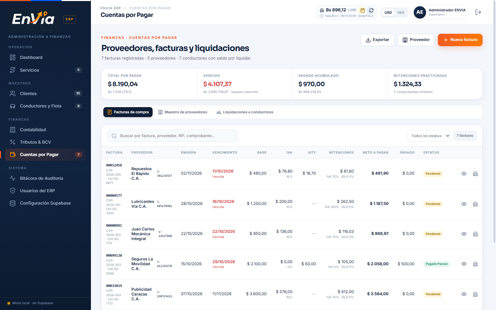

### Registrar un proveedor
1. Ve al menú lateral → **Cuentas por Pagar** → **Proveedores** (o **Facturas** / **Pagos**).
2. Haz clic en **Nuevo proveedor**.
3. Llena:
   - RIF (ejemplo `J-123456789` o `V-12345678`).
   - Razón social (nombre de la empresa).
   - Teléfono, correo y dirección.
   - Retención de IVA (75% o 100%).
   - Tipo de persona para el impuesto sobre la renta.
4. Presiona **Guardar**.

### Registrar una factura de compra
1. En la lista de facturas, busca el botón para agregar nueva.
2. Selecciona el proveedor.
3. Llena número de factura, número de control, fechas y concepto.
4. Ingresa los montos (base, IVA, etc.).
5. El sistema calcula automáticamente las retenciones de IVA e ISLR.
6. Presiona **Guardar**.

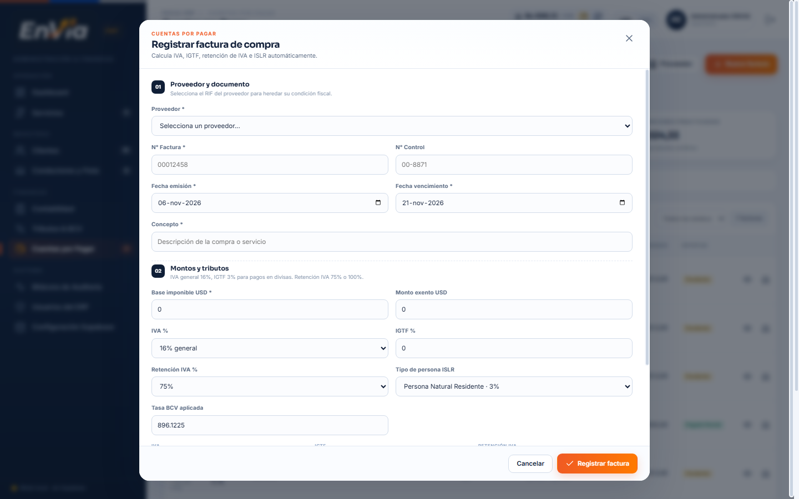

### Pagar una factura
1. En la lista, busca la factura pendiente.
2. Haz clic en **Pagar**.
3. Ingresa el monto, método de pago y referencia.
4. Presiona **Guardar**.

> No se puede eliminar una factura que ya tenga pagos registrados.

---

## 8.1 Negocios Asociados

**Negocios Asociados** es un módulo independiente para los comercios aliados que generan pedidos de delivery: restaurantes, farmacias, comercios, servicios y otros. Se recomienda mantenerlo separado de **Cuentas por Pagar** porque su naturaleza contable es distinta: un asociado puede deberte comisiones (**cuenta por cobrar**) y, al mismo tiempo, tú puedes deberle recaudaciones en efectivo cobradas al cliente final (**cuenta por pagar**). Mezclarlo con proveedores de compras confundiría la antigüedad de CxP y los reportes fiscales.

### Registrar un negocio
1. Ve al menú lateral → **Negocios Asociados** → **Listado de negocios** (o **Nuevo negocio**).
2. Pulsa **Nuevo negocio**.
3. Llena RIF, razón social, tipo, contacto, teléfono, correo, dirección y el **% de comisión** pactado.
4. Define el estatus (Activo / Inactivo) y guarda.

### Registrar movimientos de cartera
Desde la ficha del negocio puedes registrar cuatro tipos:

| Movimiento | Efecto | Asiento |
|---|---|---|
| Comisión por cobrar | Aumenta la cuenta por cobrar | DEBE 1.1.2.03 · HABER 4.2.1.02 |
| Cobro recibido | Reduce la cuenta por cobrar | DEBE 1.1.1.02 · HABER 1.1.2.03 |
| Recaudación por pagar | Aumenta la cuenta por pagar | DEBE 1.1.1.01 · HABER 2.1.1.03 |
| Pago al negocio | Reduce la cuenta por pagar | DEBE 2.1.1.03 · HABER 1.1.1.02 |

La ficha muestra el saldo por cobrar, el saldo por pagar y el historial completo. No se puede eliminar un negocio con movimientos registrados.

---

## 8.2 Tienda & Inventario del conductor

La **Tienda del Conductor** permite vender uniformes, equipamiento y seguridad a los conductores y financiar la compra contra su cartera.

### Catálogo e inventario
1. Ve al menú lateral → **Tienda & Inventario** → **Catálogo e inventario** (o **Nuevo producto** / **Asignar producto**).
2. En **Nuevo producto** define SKU, nombre, categoría, precio de venta, costo, stock actual y stock mínimo.
3. Puedes **ajustar stock** con el icono de refresco (compra, devolución, merma) y editar el producto.
4. Haz clic sobre la fila de un producto para abrir su **ficha de consulta**: disponibilidad actual, economía, financiamientos y **kardex resumido**. La ficha es de solo lectura; para modificar usa **Editar producto**.
5. El sistema resalta los productos en o bajo el stock mínimo y calcula el valor del inventario al costo.

Productos de demostración incluidos: Bolso Delivery ($80), Franela manga larga tipo chemis ($25), Casco personalizado ($50), Seguro RCV ($25), Chaqueta cortaviento ($50) y Portacelular ($25).

### Asignar y financiar una compra
1. Pulsa **Asignar producto** (o hazlo desde el expediente del conductor).
2. Selecciona conductor, producto, cantidad y número de cuotas (1, 2, 4, 8, 12 o 24).
3. El sistema muestra el total y la cuota estimada.
4. Al confirmar: descuenta stock, crea una **cuenta por cobrar al conductor** (1.1.2.02), registra el ingreso por tienda (4.2.1.03) y el costo del artículo (5.2.2.01). La ventana se cierra y regresas al catálogo de inventario.
5. En **Financiamientos** puedes ver el saldo y usar **Abonar** para registrar pagos parciales.

La deuda aparece en la **Wallet del conductor** y puede descontarse de sus liquidaciones.

---

## 9. Bitácora de Auditoría

Esta sección registra todo lo que se hace en el sistema para tener un control de quién modificó qué.

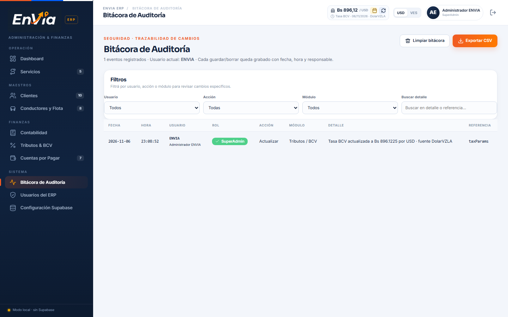

### Qué se registra
Cada vez que guardas o borras algo (cliente, conductor, servicio, factura, asiento contable, usuario, tasa del dólar, etc.), el sistema anota:
- **Usuario:** Quién hizo el cambio.
- **Fecha y hora:** Cuándo sucedió.
- **Acción:** Qué se hizo (crear, actualizar, eliminar, pagar, etc.).
- **Módulo:** En qué parte del sistema (clientes, servicios, contabilidad, etc.).
- **Detalle:** Qué se modificó.
- **Referencia:** El ID del registro cambiado.

### Cómo usarla
Ve al menú lateral → **Bitácora de Auditoría**. Puedes filtrar por usuario, acción o módulo, y exportar la lista a CSV si necesitas imprimirla o revisarla en Excel.

> Solo el administrador principal puede borrar esta bitácora. Los demás solo pueden verla.

---

## 10. Usuarios del sistema

Aquí se gestionan las personas que entran al sistema, los roles y los permisos de cada rol.

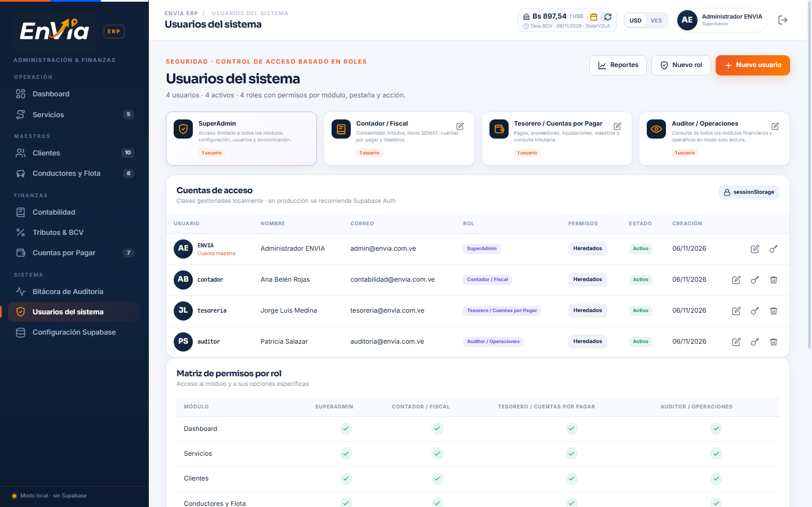

### Roles base
ENVIA ERP incluye cuatro roles listos para usar. Además, el administrador puede crear roles nuevos y ajustar sus permisos.

| Rol | Puede hacer |
|-----|-------------|
| SuperAdmin | Todo: todos los módulos, usuarios, roles y configuración. |
| Contador / Fiscal | Contabilidad, tributos, libros, cuentas por pagar, maestros y reportes. |
| Tesorero / CxP | Pagos, proveedores, liquidaciones, maestros, consulta tributaria y reportes. |
| Auditor / Operaciones | Consultar los módulos asignados, sin crear, editar ni eliminar. |

### Crear o editar un rol
1. Ve al menú lateral → **Usuarios del sistema** → **Usuarios** (o **Roles**).
2. En la tarjeta del rol, haz clic en el lápiz para editar sus permisos, o en **Nuevo rol** para crear uno.
3. Escribe el nombre, una descripción y elige un icono.
4. En la matriz de permisos, activa **Acceso** para cada módulo que verá el rol. Eso habilita el módulo y sus pestañas, con la acción **Ver / consultar**.
5. Marca **Todo** si el rol tendrá acceso completo a ese módulo, o selecciona solo las **opciones / pestañas** y **acciones** permitidas.
6. Presiona **Guardar**.

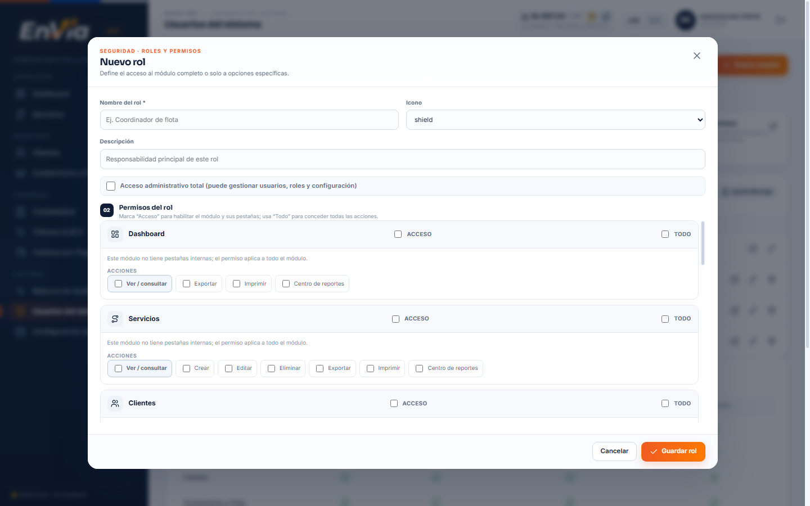

Las acciones disponibles incluyen ver, crear, editar, eliminar, exportar, imprimir, abrir el centro de reportes, gestionar documentos, liquidar, pagar, cobrar, registrar movimientos de cartera, asignar productos/financiar, administrar la billetera y administrar roles. Los módulos con pestañas internas, como Contabilidad o Cuentas por Pagar, permiten habilitar cada pestaña por separado. Los roles base ya incluyen acceso a **Negocios Asociados** y **Tienda & Inventario**; el administrador puede ajustarlo por rol o por usuario.

### Crear un usuario nuevo
1. Ve al menú lateral → **Usuarios del sistema** → **Usuarios**.
2. Haz clic en **Nuevo usuario**.
3. Llena usuario, clave, nombre, correo y asigna un rol.
4. Si necesitas un trato especial, activa **Permisos personalizados para este usuario** y ajusta la matriz. Estos permisos reemplazan los del rol solo para esa persona.
5. Presiona **Guardar**.

### Otras acciones
- **Cambiar clave:** usa el icono de llave en la fila del usuario.
- **Editar:** usa el lápiz para cambiar datos, rol, estado o permisos personalizados.
- **Eliminar rol:** solo se permite en roles personalizados que no estén en uso por usuarios.
- **SuperAdmin:** conserva acceso total y no puede degradarse desde la interfaz.

> El usuario `ENVIA` es la cuenta maestra: no se puede eliminar ni cambiar de rol. La sesión expira a las 12 horas.

---

## 10. Configuración del Sistema

Aquí se gestionan los parámetros del sistema, los planes y eventos de conductores, las integraciones con APIs externas, el Asistente ChatBot, la conexión con Supabase y los respaldos.

El menú lateral de este módulo respeta el mismo orden que las secciones de la pantalla:

1. Parámetros de mantenimiento
2. Planes de conductores
3. Eventos de conductores
4. Integración de APIs
5. Configuración de Asistente ChatBot
6. Credenciales Supabase
7. Estado de conexión
8. Mapa de sincronización
9. Respaldo y restauración
10. Reportes

Al elegir cualquiera de estas opciones, la pantalla se desplaza directamente a la sección correspondiente, dejándola visible debajo de la barra superior (sin quedar tapada).

### Parámetros de mantenimiento
1. Ve al menú lateral → **Configuración del Sistema** → **Parámetros de mantenimiento**.
2. Verás una tabla con los parámetros existentes (clave, etiqueta, módulo, aplicación, tipo, valor y descripción).
3. Para crear uno nuevo, haz clic en **Nuevo parámetro** y llena:
   - **Clave:** identificador único en minúsculas, números y guion bajo (ej: `param_porcentaje_evento1`).
   - **Etiqueta:** nombre descriptivo que se mostrará en la tabla.
   - **Módulo:** selecciona de la lista desplegable el módulo al que pertenece (Conductores, Clientes, Servicios, etc.).
   - **Tipo:** texto, monto, porcentaje, booleano o fecha.
   - **Nivel (opcional):** Zafiro, Esmeralda o Diamante si el parámetro aplica a un nivel específico.
   - **Tipo de plan (opcional):** tarifa fija o porcentual, si el parámetro se vincula al esquema de descuento del conductor.
   - **Valor:** el valor del parámetro.
   - **Descripción:** explica qué controla este parámetro. Es informativa: la lógica la definen la clave, el tipo, el valor y el módulo.
4. Para editar o eliminar, usa los iconos de lápiz o basura en cada fila.

### Planes de conductores
1. Ve al menú lateral → **Configuración del Sistema** → **Planes de conductores**.
2. Cada plan define el descuento semanal de un nivel y su tipo: **tarifa fija** (monto en USD) o **tarifa porcentual** (% de lo generado en la semana).
3. Usa **Nuevo plan** para crear un plan, o los iconos de lápiz y basura para editarlo o eliminarlo.
4. El conductor toma el plan que coincida con su nivel y con la **Tarifa del conductor** elegida en su expediente.

### Eventos de conductores
1. Ve al menú lateral → **Configuración del Sistema** → **Eventos de conductores**.
2. Crea premios o descuentos aplicables a **todos** los conductores o a un **nivel** específico, con valor en monto o porcentaje.
3. Desde el expediente del conductor puedes aplicar los eventos vigentes a su wallet.

### Integración con APIs externas
1. Ve al menú lateral → **Configuración del Sistema** → **Integración de APIs**.
2. Aquí ves las APIs configuradas (ej: Tasa BCV Dólar, SENIAT ISLR, SENIAT IVA) con su estado (Activa/Inactiva, Sincronizada/Pendiente).
3. Para agregar una nueva, haz clic en **Nueva API** y llena clave, nombre, endpoint y descripción.

### Configuración de Asistente ChatBot
1. Ve al menú lateral → **Configuración del Sistema** → **Asistente ChatBot**.
2. Pega la **API Key de Google Gemini**. Se guarda solo en `localStorage` de este navegador (`envia_chatbot_v1`); no se sincroniza con Supabase.
3. Revisa el **Modelo**. El valor por defecto es `gemini-1.5-pro`; puedes cambiarlo por otro modelo habilitado en Google AI Studio.
4. Pulsa **Guardar Credenciales IA**. La app guarda y comprueba la conexión; el resultado aparece en la misma sección.
5. Abre el asistente con el botón flotante **Asistente ENVIA** o con **Abrir asistente**. Verás cuatro preguntas rápidas; al pulsar una se envía sola y desaparecen.
6. Mientras Gemini responde verás **Pensando...**. Las respuestas aceptan **negritas**, listas y código en línea; el contenido se escapa para evitar HTML inseguro.
7. El asistente solo consulta los módulos habilitados para tu rol. Si preguntas por un módulo bloqueado, rechazará la consulta. Si no hay API Key, el chat pedirá configurarla antes de enviar.
8. **Nueva conversación** borra el historial local de la ventana. La clave permanece guardada hasta que la borres desde la configuración del navegador.

> **Seguridad:** la API Key queda en el navegador y se envía directamente a Google Gemini. Para producción usa un proxy backend; no guardes claves privadas ni `service_role` en el frontend.

### Configuración Supabase
1. Ve al menú lateral → **Configuración del Sistema** → **Credenciales Supabase**.
2. Ingresa la URL del proyecto y la anon key.
3. Prueba la conexión y guarda la configuración.

### Estado de conexión
Muestra si la API REST y el Storage están configurados, la fecha de la última prueba y de la última sincronización, la cantidad de tablas del esquema y los tres buckets de documentos.

### Mapa de sincronización
Lista cada tabla local con su tabla remota, clave de conflicto, cantidad de registros y estado (Listo o Local). Desde aquí puedes descargar clientes y conductores cuando Supabase está configurado.

> La sincronización espera como máximo **20 segundos por solicitud**. Si la red o Supabase no responden, el botón se libera y se muestra el detalle del error; revisa la URL, la anon key, las políticas RLS y la conexión. Los campos opcionales vacíos, como la fecha de fin o el nivel de un evento, se envían como `NULL` para que PostgreSQL no rechace el registro.

### Resumen de errores de sincronización
Si una o más tablas no se pueden sincronizar, la app abre una ventana con el resumen de errores. Cada tabla muestra:

- El nombre de la entidad y su tabla remota.
- La cantidad de registros locales.
- El mensaje técnico devuelto por Supabase.
- Una pista para corregir el dato antes de volver a sincronizar.
- **Registros a corregir:** la cédula/RIF o el número del registro, su nombre o descripción, los campos faltantes o sobrantes y, cuando aplica, el valor permitido.

En el **Mapa de sincronización**, las tablas que fallaron quedan marcadas con el estado **Error**. Pulsa ese estado para abrir el detalle de esa tabla y ver exactamente qué registro debes corregir. Las tablas que sí se actualizaron muestran **Sincronizado**.

Puedes cerrar la ventana con la **X**, con el botón **Entendido** o haciendo clic fuera de ella. Después, usa **Ver resumen de errores** en el mapa de sincronización para volver a abrirla. Las tablas que sí se sincronizaron no se pierden.

### Respaldo y restauración
1. **Exportar respaldo JSON:** descarga la base local y los archivos en un solo archivo.
2. **Importar respaldo:** restaura un respaldo exportado previamente.
3. **Restaurar datos demo:** vuelve a la base de demostración. Úsalo con precaución.

> Los datos se guardan en el navegador. Si trabajas sin Supabase, exporta un respaldo periódicamente.

---

## 11. Reportes en cada módulo

Todos los módulos tienen el botón **Reportes** en la esquina superior derecha. Abre el catálogo de reportes del módulo actual y permite imprimir o descargar en Excel sin salir de la pantalla.

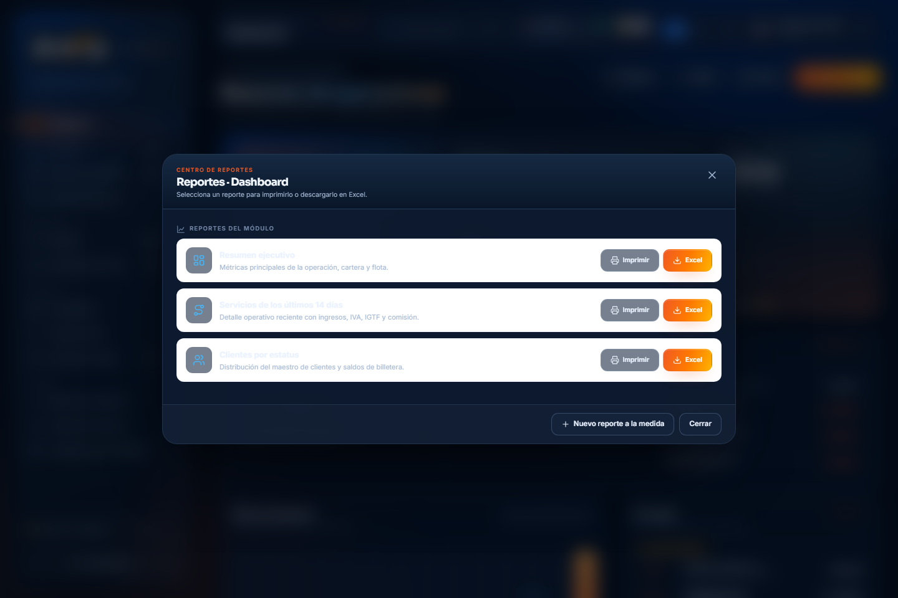

### Cómo usar el centro de reportes
1. Entra al módulo que necesitas (Clientes, Conductores, Servicios, Contabilidad, etc.).
2. Haz clic en **Reportes**.
3. Elige el reporte que necesitas de la lista.
4. Usa **Imprimir** para abrir el diálogo de impresoras del navegador. También puedes elegir “Guardar como PDF”.
5. Usa **Excel** para descargar un archivo `.xls` con los mismos datos y totales.
6. Cierra el centro con la **X** o con el botón **Cerrar**.

### Crear reportes personalizados (según rol y perfil)

Los usuarios con permiso de escritura y de **Centro de reportes** pueden crear listados nuevos con la información que ya está almacenada, sin depender de los reportes predefinidos. Por ejemplo: todos los conductores con su correo y dirección, o todos los usuarios con su nombre y correo. El constructor solo muestra los módulos y las tablas de datos a los que el rol o el perfil del usuario tienen acceso.

1. Entra al módulo donde quieres ver el reporte y haz clic en **Reportes**.
2. Pulsa **Nuevo reporte a la medida**.
3. Escribe un **nombre** y una **descripción**.
4. Elige el **módulo** donde aparecerá el reporte y la **tabla base** disponible según tu acceso.
5. Marca las **columnas** que quieres mostrar.
6. Si lo necesitas, agrega un **filtro** (contiene, igual a, mayor que o menor que) y un **orden** ascendente o descendente.
7. Pulsa **Crear reporte**. El listado aparecerá en la sección **Reportes personalizados** del centro, con las mismas acciones **Imprimir** y **Excel**.
8. Para cambiarlo, usa el lápiz; para eliminarlo, usa el cesto. Eliminar el reporte no borra los datos de las tablas, solo la definición del listado.

> Cada usuario puede editar o eliminar sus propios reportes; el administrador puede gestionar todos. Los roles de solo lectura pueden ejecutar los reportes existentes, pero no ven el botón **Nuevo reporte a la medida** ni tablas de módulos a los que no tienen acceso.

### Reportes disponibles por módulo

| Módulo | Reportes principales |
|--------|----------------------|
| Dashboard | Resumen ejecutivo, servicios de los últimos 14 días, clientes por estatus. |
| Servicios | Listado general, ingresos por tipo de servicio y comisiones por conductor. |
| Clientes | Maestro de clientes, saldos de billetera y clientes por estatus. |
| Conductores y Flota | Maestro de conductores y flota, conductores por nivel y saldos por liquidar. |
| Contabilidad | Libro diario, libro mayor, balance de comprobación, estado de resultados, balance general, libro de ventas y libro de compras. |
| Tributos & BCV | Resumen fiscal, comprobantes de retención, retenciones de IVA y retenciones de ISLR. |
| Cuentas por Pagar | Facturas de compra, antigüedad de saldos, maestro de proveedores y liquidaciones a conductores. |
| Negocios Asociados | Cartera de comisiones, recaudaciones y movimientos por negocio. |
| Tienda & Inventario | Catálogo, stock, valor del inventario y financiamientos a conductores. |
| Bitácora de Auditoría | Bitácora completa, actividad por usuario y eventos por módulo. |
| Usuarios del sistema | Usuarios y roles, roles y permisos, matriz de permisos. |
| Configuración | Parámetros del sistema, almacenamiento y tasa BCV. |

> El botón **Reportes** solo aparece si el rol o el usuario tiene habilitada la acción **Centro de reportes** en ese módulo. Los reportes incluyen la tasa BCV, el usuario y la fecha de generación.

---

## 12. Reglas importantes que debes conocer

1. **La cédula / RIF no se repite:** Cada cliente y conductor tiene un identificador único. No se pueden duplicar.
2. **No se puede borrar lo que se usa:** No se puede eliminar un cliente que tenga servicios, ni un proveedor que tenga facturas, ni una cuenta contable que tenga movimientos.
3. **Todo queda registrado:** Cada cambio que hagas queda grabado en la bitácora con tu nombre, fecha y hora.
4. **El dólar es importante:** Los montos operativos se capturan en dólares y se convierten a bolívares con la tasa del día para la contabilidad.
5. **Tu sesión dura 12 horas:** Después de ese tiempo, el sistema te pedirá entrar de nuevo.
6. **El usuario ENVIA es el dueño:** Tiene acceso total y no se puede eliminar ni cambiar de rol.
7. **Los permisos se respetan:** Si no tienes una acción habilitada, el botón no aparece y la operación se rechaza aunque intentes ejecutarla.
8. **Los datos se guardan en el navegador:** La base se conserva en `localStorage` y los documentos en IndexedDB. Al recargar la página, la información sigue disponible.
9. **Cada sesión abre el Dashboard:** El sistema no vuelve al último módulo visitado.
10. **Los documentos vencidos inactivan al conductor:** Si un documento obligatorio vence, no se le pueden asignar servicios hasta actualizarlo.
11. **La tienda descuenta inventario y genera cartera:** Cada producto asignado crea una cuenta por cobrar al conductor y su asiento contable.
12. **Los negocios asociados tienen cartera propia:** Las comisiones por cobrar y las recaudaciones por pagar se controlan por separado de los proveedores.

---

## ¿Necesitas ayuda?

Si tienes dudas sobre cómo usar algún módulo, contacta al administrador del sistema en tu empresa o revisa la sección correspondiente de este manual.

ENVIA ERP — Gestión de movilidad, encomiendas y contabilidad venezolana.
